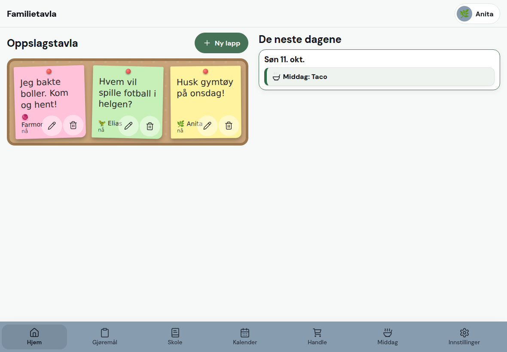

# Familietavla (workshopkopi)

En mobilvennlig familietavle: oppslagstavle, kalender, middagsplan, handleliste, gjøremål med poeng, lekser og mer, i én nettapp. Bygget i små steg sammen med Claude Code, og delt som utgangspunkt for en praktisk workshop om å lage bedre løsninger med KI.

Dette er en **ren kopi** med oppdiktede brukere. Ingenting her tilhører en ekte familie.



## Kom i gang (10 minutter)

Du gjør dette én gang, på din egen Mac eller PC. Alle kommandoene skrives i **terminalen**, et vindu der du skriver og trykker Enter. Der Mac og PC er forskjellige, åpner du valget som passer deg. Du trenger ingen API-nøkkel og ingen konto.

### 1. Installer to programmer (første gang)

Node.js kjører appen, og Git henter prosjektet.

<details>
<summary><b>Jeg bruker Mac</b></summary>

Last ned **Node.js** (versjon 22 eller nyere) fra [nodejs.org](https://nodejs.org) og installer som vanlig. Git trenger du ikke laste ned. Mac tilbyr å installere det første gang det trengs, og da trykker du bare «Installer».

</details>

<details>
<summary><b>Jeg bruker PC (Windows)</b></summary>

Last ned **Node.js** (versjon 22 eller nyere) fra [nodejs.org](https://nodejs.org) og **Git** fra [git-scm.com](https://git-scm.com). Installer begge som vanlig og godta forslagene underveis.

</details>

### 2. Åpne terminalen

<details>
<summary><b>Mac</b></summary>

Trykk **Cmd + mellomrom**, skriv **Terminal** og trykk Enter.

</details>

<details>
<summary><b>PC (Windows)</b></summary>

Trykk **Windows-tasten**, skriv **PowerShell** og trykk Enter.

</details>

Sjekk at Node virker. Du skal se `v22.13` eller høyere.

```bash
node -v
```

Ser du et lavere tall (for eksempel `v22.12.0`), eller `command not found`, må du installere Node på nytt fra [nodejs.org](https://nodejs.org) før du går videre. Med for gammel versjon feiler appen med meldingen `No such built-in module: node:sqlite`. Lukk og åpne terminalen igjen etter installasjonen, og kjør `node -v` på nytt.

### 3. Last ned prosjektet

Dette lager en ny mappe som heter `familietavla`, der terminalen står akkurat nå. Mac og PC bruker samme kommando.

```bash
git clone https://github.com/hodneirik/familietavla-workshop familietavla
```

### 4. Gå inn i mappen

`cd` betyr «gå inn i». Alle kommandoene som kommer etter dette må kjøres herfra.

```bash
cd familietavla
```

Står du fast senere? Skriv `ls` (Mac) eller `dir` (PC) for å se hvilken mappe du er i. Du skal se `README.md` og `package.json`. Ellers har du glemt dette steget.

### 5. Installer det appen trenger

Det tar et minutt eller to, og det kommer mye tekst. Det er normalt.

```bash
npm install
```

<details>
<summary><b>PC: feilmelding om at kjøring av skript er deaktivert?</b></summary>

Åpne **Ledetekst** (skriv «cmd» i startmenyen) i stedet for PowerShell. Gå inn i mappen med `cd familietavla` og bruk de samme kommandoene.

</details>

### 6. Lag innstillingsfilen

Du kopierer en ferdig mal og trenger ikke endre noe i den. Her er kommandoen ulik på Mac og PC.

<details>
<summary><b>Mac</b></summary>

```bash
cp .env.example .env
```

</details>

<details>
<summary><b>PC (Windows)</b></summary>

```bash
copy .env.example .env
```

</details>

### 7. Lag demofamilien

Dette fyller appen med en oppdiktet familie. Du får beskjed om at Anita, Elias, Nelly og Farmor er laget.

```bash
npm run seed:demo
```

### 8. Start appen

La terminalvinduet stå åpent. Appen kjører så lenge vinduet er åpent.

```bash
npm run dev
```

### 9. Åpne appen og logg inn

Åpne <http://localhost:5173> i nettleseren. Start gjerne med Anita.

Logg inn med:

| Bruker | Rolle         | PIN  |
| ------ | ------------- | ---- |
| Anita  | forelder      | 1111 |
| Elias  | barn          | 2222 |
| Nelly  | barn          | 3333 |
| Farmor | besteforelder | 4444 |

Vil du sjekke at alt er på plass? Åpne et **nytt** terminalvindu, gå inn i mappen med `cd familietavla` og kjør `npm test`. Går alt grønt, er du klar. Vil du stoppe appen, trykker du **Ctrl + C** i vinduet der den kjører (Mac og PC).

Vil du starte på nytt? Slett mappen `server/data` og kjør `npm run seed:demo` igjen.

Oppskriften og oppgavene til workshopen står i **[WORKSHOP.md](WORKSHOP.md)**. Hvordan appen er bygget står i **[docs/ARKITEKTUR.md](docs/ARKITEKTUR.md)**.

## Kommandoer

```bash
npm run dev            # server (3000) og nettside (5173) med hot reload
npm test               # alle tester (server og web)
npm run lint           # eslint
npm run typecheck      # TypeScript
npm run format         # prettier
npm run build          # bygg for drift
npm run cli -- list-users   # kommandolinje for brukere, backup og demodata
```

Før du sender inn en endring: `npm test && npm run lint && npm run typecheck && npm run format:check`. Det samme kjører i GitHub Actions.

## Valgfritt

- **Docker:** `docker compose up --build`, og last inn demofamilien med `docker compose exec app node dist/cli/index.js seed-demo`.
- **KI i appen** (ukeplan som PDF, middagsforslag for voksne) er av til du legger en `ANTHROPIC_API_KEY` i `.env`. Resten av appen virker uten.
- **Værvarsel** er på og henter fra et eksternt API (trenger nett). Får du brannmurtrøbbel, sett `VAER_AKTIV=false` i `.env`. Resten av appen virker uten.

## Lisens

MIT, se [LICENSE](LICENSE). Bruk, endre og del fritt.
